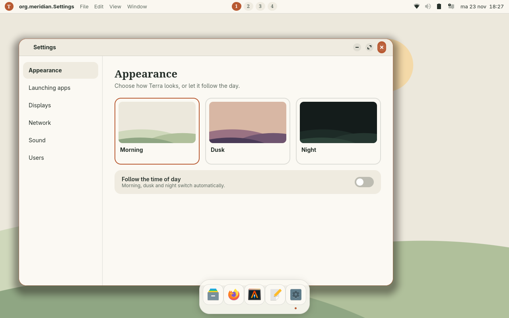

# Meridian

**Terra** is a Wayland desktop for Arch Linux, written in Rust. **Meridian** is
its compositor, built on [Smithay](https://github.com/Smithay/smithay). Around
it are small separate programs for the bar, dock, launcher, notifications,
desktop icons, settings and lock screen.



What it has:

- three moods (Morning, Dusk, Night) that follow the time of day, with a
  landscape wallpaper drawn in the mood's colors
- rounded windows with shadows and title bars, floating or tiled, on four spaces
- a top bar with space markers and a tray; a dock that can stay, auto-hide,
  or step aside for Find
- Find: one search field for apps, files, settings and actions
- notifications, desktop icons, a lock screen and a Settings app

**Status: early.** Everything above runs nested inside another desktop. The
real-session backend (started from a text console or a login manager) has not
been tested on hardware yet, and unlocking the lock screen with a real
password has not been tested either. See "Known gaps" at the end.

The design mockups are in `docs/design/`.

## Install (Arch Linux)

```sh
git clone https://github.com/BrentWebBE/Meridian.git meridian && cd meridian/packaging/arch
makepkg -si          # builds the package and installs it with pacman
```

Remove it again with `sudo pacman -R meridian-git`.

## Run

Nested, inside your current desktop (safe for trying things out):

```sh
meridian-comp                      # or: cargo run -p meridian-comp
meridian-comp alacritty            # start with a client
```

As a real session: switch to a text console (Ctrl+Alt+F3), log in, and run

```sh
meridian-comp 2> ~/meridian.log
```

or pick "Meridian" in your login manager. On a hybrid-graphics laptop you can
choose the GPU with `MERIDIAN_DRM_DEVICE=/dev/dri/cardN`.

## Keys

`Mod` is **Super** in a real session and **Alt** when nested.

| Keys                     | Action                                        |
|--------------------------|-----------------------------------------------|
| Super (tap), Mod+Space   | Find: apps, files, settings, actions          |
| Mod+Return               | open a terminal                               |
| Mod+Q                    | close the focused window                      |
| Mod+Tab, Mod+Shift+Tab   | focus the next / previous window              |
| Mod+1 .. Mod+4           | go to a space                                 |
| Mod+Shift+1 .. 4         | move the focused window to a space            |
| Mod+O                    | overview: window thumbnails and spaces        |
| Mod+T                    | switch between floating and tiled             |
| Mod+D                    | keyboard to the dock (arrows, Enter, Esc)     |
| Mod+L                    | lock the screen                               |
| Mod+left-drag            | move a window (or drag its title bar)         |
| Mod+right-drag           | resize a window (or drag its border)          |
| Print                    | screenshot to `~/Pictures/Screenshots`        |
| Mod+Shift+E              | quit Meridian                                 |
| Ctrl+Alt+F1 .. F12       | switch virtual terminal (real session)        |

In Find: Up and Down move the highlight, Enter opens it, Tab completes the
field to it, Esc closes.

To change keys, add a `[keybindings]` section to
`~/.config/meridian/config.toml`. It replaces all defaults, so copy the
section from `/usr/share/doc/meridian-git/config.toml` and edit it:

```toml
[keybindings]
"Mod+Return" = "spawn-terminal"
"Mod+B" = { spawn = "firefox" }
"Mod+2" = { workspace = 2 }
```

Keys are modifiers (`Mod`, `Super`, `Alt`, `Ctrl`, `Shift`) and one XKB key
name joined by `+`. Actions: `spawn-terminal`, `close-window`, `quit`,
`toggle-layout`, `focus-next`, `focus-previous`, `screenshot`,
`toggle-overview`, `focus-dock`, `lock`, `{ spawn = "command" }`,
`{ workspace = N }`, `{ move-to-workspace = N }`.

## Find

Tap Super (or Mod+Space, or the logo button) and type. Find shows, in groups:

- **Apps** from `.desktop` files, matched fuzzily: `ffx` finds Firefox.
- **Actions**: overview, terminal, screenshot, layout, spaces, log out,
  sleep, restart, shut down.
- **Settings**: the three moods and "Follow the time of day".
- **Files** by name from your home folder. Hidden folders and build folders
  (`target`, `node_modules`, ...) are skipped; the index holds at most
  60,000 files and is refreshed at most every two minutes.

Up and Down move the highlight, Enter opens it, Tab completes the field to
it, Esc closes. The strip at the bottom lists running apps.

## Lock screen

Mod+L (or "Lock the screen" in Find) starts `meridian-lock`. The compositor
then shows only the lock screen and sends input nowhere else until the
password is accepted. If the lock program crashes, the session stays locked
and the program is started again.

Passwords are checked with PAM using `/etc/pam.d/meridian-lock`, which the
package installs. Without that file `meridian-lock` refuses to lock, because
no password could ever be accepted.

If you cannot get back in (for example after changing PAM rules), switch to
another console with Ctrl+Alt+F3, log in there and run `pkill meridian-comp`.
That ends the Meridian session.

## Configure

Copy `/usr/share/doc/meridian-git/config.toml` (or
`meridian-common/resources/default-config.toml`) to
`~/.config/meridian/config.toml`. It covers the mood, wallpaper, start layout,
terminal, autostart programs, keyboard layout, output scale, tiling gaps,
pinned dock apps and keybindings.

### Moods

Terra has three moods: Morning, Dusk and Night. By default the mood follows
the clock (morning from 6:00, dusk from 17:00, night from 21:00). To pin one:

```toml
[appearance]
theme = "dusk"
follow-time-of-day = false
wallpaper = "~/Pictures/photo.jpg"   # optional; empty = the drawn landscape
```

To change colors, copy `/usr/share/doc/meridian-git/themes.toml` to
`~/.config/meridian/themes.toml` and edit the tokens you want.

Changes apply as soon as the file is saved: the compositor and the shell
programs watch it (inotify). The Settings app writes the same file. Keyboard
layout and output scale still need a restart.

### Launching apps

```toml
[dock]
mode = "dock"          # "dock", "auto-hide" or "off" (Find only)
position = "bottom"    # "bottom", "left" or "right"
running-dots = true
```

## Components

| Crate             | Purpose                                              |
|-------------------|------------------------------------------------------|
| `meridian-comp`   | the compositor                                       |
| `meridian-bar`    | top bar (GTK 4, layer-shell)                         |
| `meridian-dock`   | dock (GTK 4, layer-shell)                            |
| `meridian-launcher` | Find: search apps and recent files, running apps, power |
| `meridian-notify` | notification daemon (`org.freedesktop.Notifications`) |
| `meridian-settings` | Settings app: Appearance and Launching apps         |
| `meridian-desktop` | desktop icons: Home, Documents, Projects, Trash      |
| `meridian-lock`   | lock screen (ext-session-lock-v1, PAM)               |
| `meridian-common` | shared config, theme tokens and the IPC protocol     |

The shell programs are ordinary Wayland clients. They learn about windows from
the compositor over a small JSON socket (`$MERIDIAN_SOCKET`, see
`meridian-common/src/ipc.rs`). The settings app is added in a later phase.

Try a notification with `notify-send "Hello" "from Meridian"`. Only one
notification daemon can run per login session, so inside GNOME or KDE (nested
mode) `meridian-notify` exits and the host desktop keeps showing them.

Building needs `gtk4` and `gtk4-layer-shell` installed (`makepkg -s` does that).

## Known gaps

- The real-session backend drives one GPU. On a hybrid laptop, monitors wired
  to the second GPU stay dark. It has not been run on hardware yet.
- Unlocking the lock screen with a real password has not been tested.
- No XWayland: X11-only apps do not open.
- Integer output scale only (1, 2, 3).
- The app menu in the bar is a stub; Displays, Network, Sound and Users in
  Settings are placeholders.
- No animations except the auto-hide dock; no idle timer that locks the screen.
- Popups do not close when you click outside them.

## License

MIT
