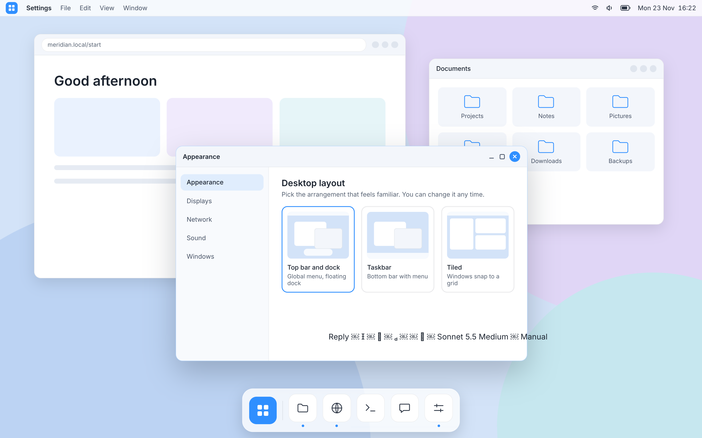

# Meridian

A Wayland desktop environment and window manager for Arch Linux, written in Rust
on top of [Smithay](https://github.com/Smithay/smithay). The goal: the structure
of macOS (global menu bar, dock, overview) with the friendliness of Zorin OS.

**Status: phase 2 of 6.** The compositor runs nested in a window or as a real
session from a TTY, with configurable keybindings and floating/tiled layouts.
There is no bar, dock or launcher yet. The real-session backend is new and has
had little hardware testing.



## Install (Arch Linux)

```sh
git clone https://github.com/BrentWebBE/Patina.git meridian && cd meridian/packaging/arch
makepkg -si          # builds the package and installs it with pacman
```

Remove it again with `sudo pacman -R meridian-git`.

## Run

Nested, inside your current desktop (safe for trying things out):

```sh
meridian-comp                      # or: cargo run -p meridian-comp
meridian-comp alacritty            # start with a client
```

As a real session: switch to a text console (Ctrl+Alt+F3), log in, and run

```sh
meridian-comp 2> ~/meridian.log
```

or pick "Meridian" in your login manager. On a hybrid-graphics laptop you can
choose the GPU with `MERIDIAN_DRM_DEVICE=/dev/dri/cardN`.

| Keys                 | Action                              |
|----------------------|-------------------------------------|
| Mod+Return           | open a terminal                     |
| Mod+Q                | close the focused window            |
| Mod+T                | toggle floating / tiled             |
| Mod+Tab              | focus next window (Shift: previous) |
| Mod+left-drag        | move a window                       |
| Mod+right-drag       | resize a window                     |
| Mod+Shift+E          | quit                                |
| Ctrl+Alt+F1..F12     | switch virtual terminal             |

`Mod` is **Super** in a real session and **Alt** when nested.

## Configure

Copy `/usr/share/doc/meridian-git/config.toml` (or
`meridian-common/resources/default-config.toml`) to
`~/.config/meridian/config.toml`. It covers the start layout, terminal,
keyboard layout, output scale, tiling gaps and keybindings. Restart Meridian
to apply changes.

## Layout

| Crate             | Purpose                                 |
|-------------------|-----------------------------------------|
| `meridian-comp`   | the compositor                          |
| `meridian-common` | shared config and theme tokens          |

The bar, dock, launcher, notification daemon and settings app are added as
separate crates in later phases.

## License

MIT
